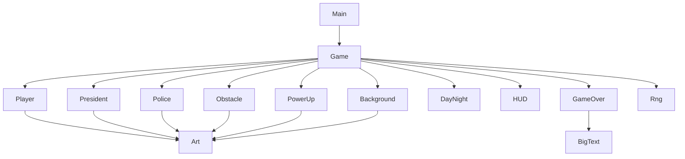
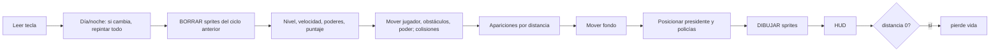

# Arquitectura

## Bucle principal (`Game.step`, un ciclo)

## Por qué ya no queda "estela"
Cada sprite guarda el rectángulo que dibujó (`ox, oy, ow, oh`). Al inicio del ciclo siguiente se borra **ese**
rectángulo con el color de fondo y recién después se mueve y se vuelve a dibujar. Para que borrar con un
rectángulo liso sea correcto, la pantalla se reparte en bandas que no se mezclan:

| Banda (y) | Contenido | Quién la dibuja |
|---|---|---|
| 0–11 | franja blanca del HUD | `Background.full`, `HUD` |
| 13–140 | cielo, montañas, casas, palmas | `Background.scene` (cada 3 ciclos) |
| 141 | horizonte | `Background.full` |
| 142–215 | zona de juego (solo sprites, fondo liso) | sprites |
| 216–251 | carretera | `Background.road` |
| 255 | reservada (no se dibuja nunca) | — |

El punto más alto del salto es y=155 (y=145 con arepa), siempre dentro de la zona de juego, así que ningún sprite
toca la banda del cielo.

## Decisiones de diseño (valores ajustables)
| Decisión | Valor |
|---|---|
| Sprites | jugador 16×16 (16×8 agachado), presidente 20×24, policía 16×20, hechos con rectángulos |
| Colisión | rectángulos (AABB) más pequeños que el sprite; derecha e inferior exclusivos |
| Franja del jugador | x entre 190 y 310 |
| Distancia (`gap`) | inicia 100; choque −20; erosión por policías (−1 cada 60/45/30 ciclos con 1/2/3 policías); café +15 y +1 cada 4 ciclos |
| Salto | `vy = -9` (−10 con arepa), gravedad +1 por ciclo |
| Niveles | `score / 250`, máximo 4 (se muestra como 1–5); velocidad `4 + nivel` (+2 con café) |
| Policías visibles | `1 + nivel`, máximo 3, detrás del presidente a 22 px de separación |
| Apariciones | por distancia recorrida: `240 − 15·nivel + aleatorio(120)` px entre obstáculos |
| Día/noche | cada 700 ciclos; se invierte el color de primer plano |
| Pausa entre ciclos | `delay = 12` ms |

## Límites de Jack/Hack tenidos en cuenta
- Enteros de 16 bits (−32768..32767): el puntaje se limita a 9999 y el contador de ciclos se reinicia en 6000.
- Una clase con constructor **debe tener al menos un campo** (`Memory.alloc(0)` da ERR5).
- Coordenadas fuera de pantalla provocan error del sistema operativo: todo se dibuja con `Art.rect`, que recorta.
- Jack no tiene precedencia de operadores: todas las expresiones llevan paréntesis.
- No hay aleatoriedad ni reloj: `Rng` (LCG de 16 bits) y contadores de ciclos.
- Las cadenas literales se crean en cada ejecución: `HUD.text` y `BigText.drawText` las liberan tras usarlas.
